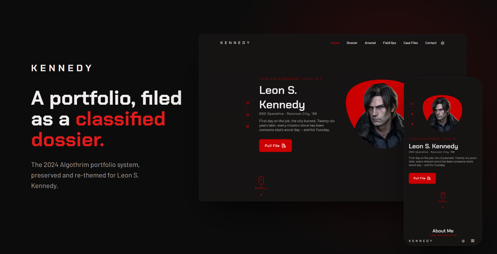
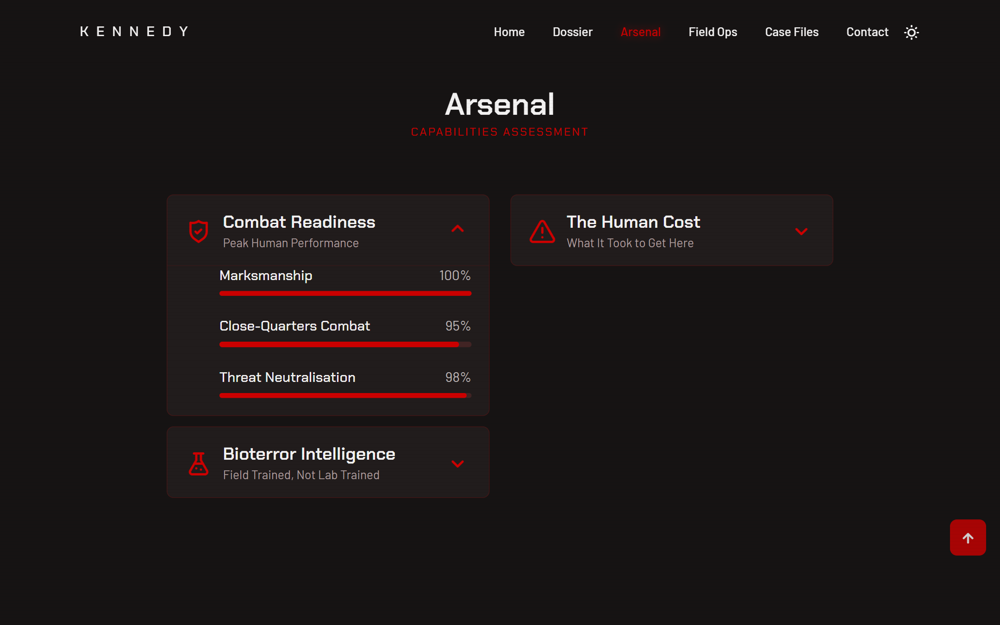
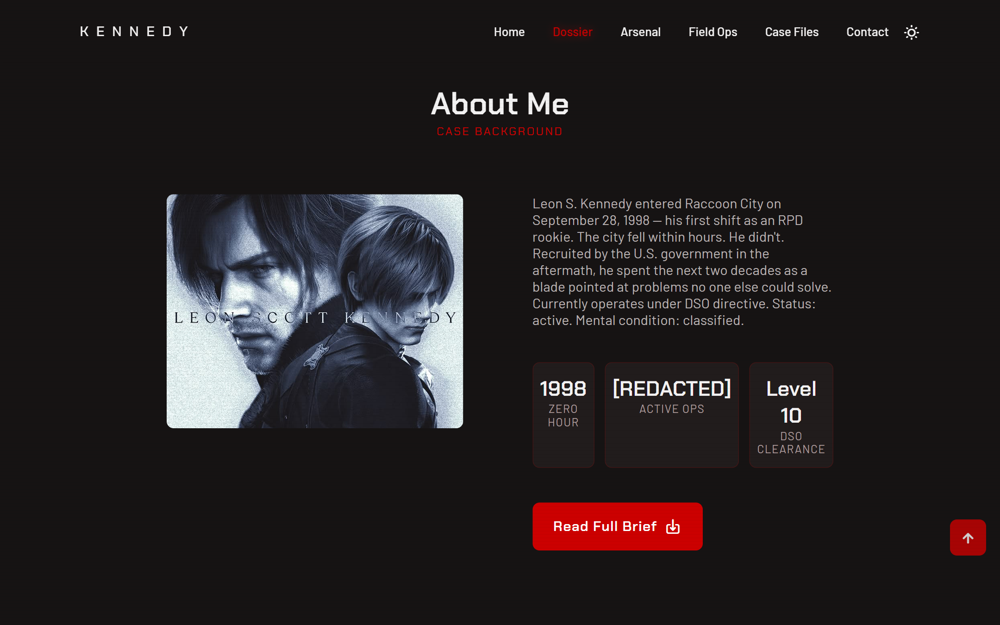
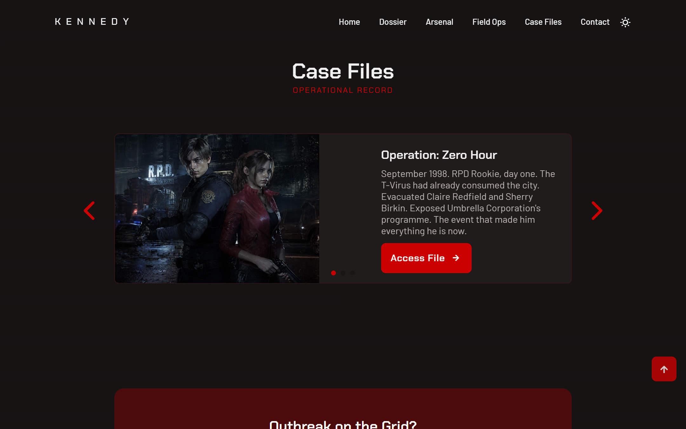
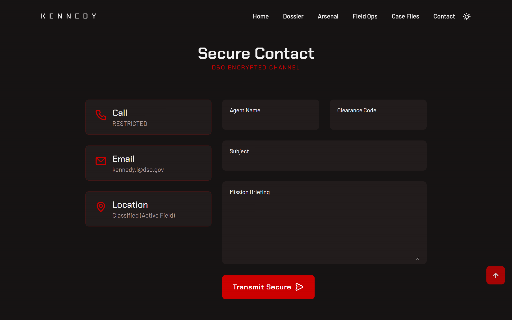
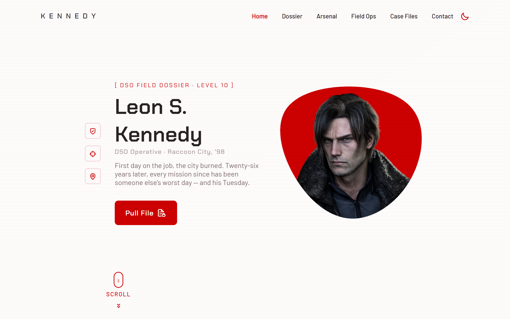
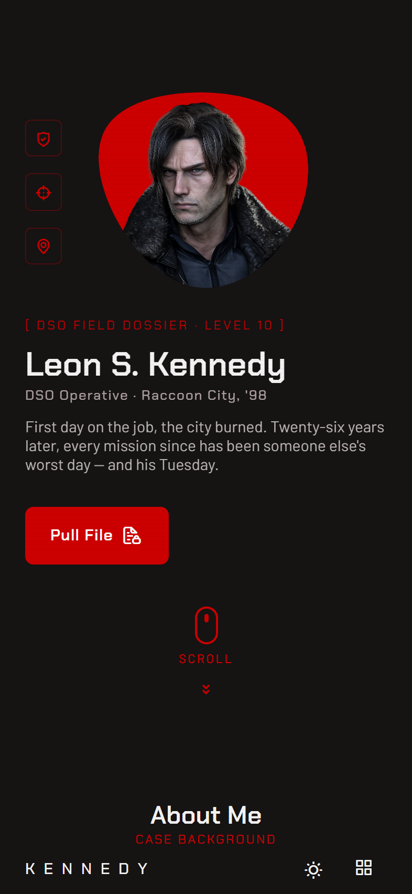
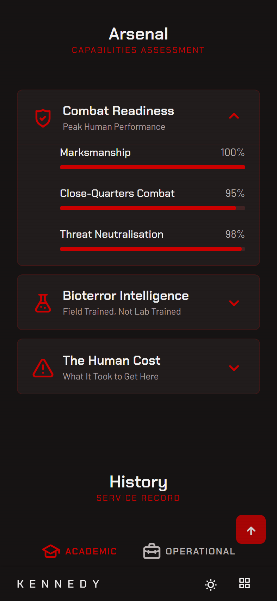

<p align="center">
  
</p>

<p align="center">
  <strong>The 2024 Algothrim portfolio system, preserved and re-themed as a DSO field dossier for Leon S. Kennedy.</strong><br>
  Every section of a personal portfolio, written in character. Vanilla HTML, CSS and JavaScript.
</p>

<p align="center">
  <a href="https://leon-kennedy-portfolio-archive.vercel.app"><strong>Open the dossier</strong></a>
  &nbsp;·&nbsp;
  <a href="#sections">Sections</a>
  &nbsp;·&nbsp;
  <a href="#design">Design</a>
  &nbsp;·&nbsp;
  <a href="#run-it-locally">Run it locally</a>
</p>

<p align="center">
  
  
  
</p>

## What this is

Before thealgothrim.com became what it is now, it ran on this layout: a one-page portfolio with an about block, skill bars, a timeline, services, a project carousel, testimonials and a contact form. Rather than delete it, the system was kept as a standalone site and re-skinned to prove how far one structure can stretch.

The subject is Leon Scott Kennedy from *Resident Evil*. The portfolio becomes a classified file: skills are an arsenal, services are field ops, projects are case files and testimonials come from Ada Wong, Claire Redfield and Hunnigan.

## Screenshots

<p align="center">
  
</p>

<table>
  <tr>
    <td align="center"><br><sub>Dossier</sub></td>
    <td align="center"><br><sub>Case files</sub></td>
  </tr>
  <tr>
    <td align="center"><br><sub>Secure contact</sub></td>
    <td align="center"><br><sub>Light mode</sub></td>
  </tr>
</table>

<p align="center">
  
  &nbsp;&nbsp;
  
</p>

## Sections

| Section | In the dossier | What it does |
| --- | --- | --- |
| Home | Home | Name, rank and a one-line operative summary |
| About | Dossier | Case background, clearance level and stat callouts |
| Skills | Arsenal | Accordion groups with animated bars |
| Qualification | History | A tabbed academic and operational timeline |
| Services | Field Ops | Three specialisation cards with detail modals |
| Portfolio | Case Files | A Swiper carousel of mission reports |
| Testimonials | Field Reviews | Assessments from people who worked with him |
| Contact | Secure Contact | An "encrypted channel" form |

## Design

- **Near black with one red.** The page sits at `hsl(0, 6%, 8%)`; `#cc0000` marks buttons, icons and active states, and a deep maroon carries the footer and alert banner.
- **Written in character.** The "Human Cost" skill group rates Survival Instinct as unmeasurable and Normal Life Maintained at 0%; the academic record ends with "City was destroyed".
- **Quiet atmosphere.** A faint scanline overlay, a rare glitch on the name, staggered entrances and skill bars that fill on load.
- **Dark by default,** with a light mode that is remembered on the device.
- **Responsive,** with a bottom navigation sheet on phones.

## Built with

| Layer | Choice |
|---|---|
| Markup and style | Semantic HTML, CSS custom properties, Chakra Petch and Barlow |
| Carousels | [Swiper](https://swiperjs.com/), bundled locally |
| Icons | Unicons |
| Hosting | Vercel |

## Run it locally

No build step. Serve the folder:

```bash
git clone https://github.com/TheAlgo7/leon-kennedy-portfolio-archive.git
cd leon-kennedy-portfolio-archive
python -m http.server 8080
```

Open http://localhost:8080. `python scripts/readme-shots.py` rebuilds the screenshots in this README from the live site.

## Licence

Copyright © 2026 Gaurav Kumar, [The Algothrim](https://thealgothrim.com). All rights reserved.

The code is public to read and learn from. It is not licensed for reuse. Leon S. Kennedy and *Resident Evil* belong to Capcom; this is a fan tribute and is not affiliated with them.
